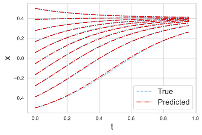
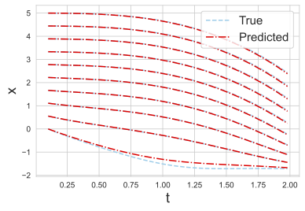
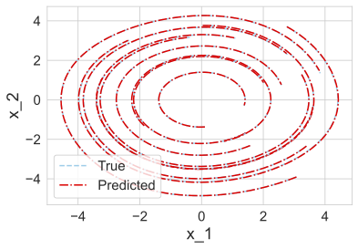

# Lipschitz Regularized Randomized Neural Networks for System Identification

## Overview
This Github repository contains the numerical implementations accompanying the paper **LR-RaNN: Lipschitz Regularized Randomized Neural Networks for System Identification**. The numerical experiments evaluate the performance of proposed method on several dynamical systems and provide numerical verification of theory. Our experiments also contain comparison with Lipschitz Neural Network (LNN) and Neural Network with Lipschitz regualrization term (LRNN).

## Publications
A detailed description of the model, methodology, and numerical results is available in the following publication:

- Title: **LR-RaNN: Lipschitz Regularized Randomized Neural Networks for System Identification**
- Author: Chunyang Liao
- Conference Proceeding: *Proceedings of the 1st Conference on Topology, Algebra, and Geometry in Data Science(TAG-DS 2025)*, 2025
- Doi: [doi](https://proceedings.mlr.press/v321/liao26a.html)

```bibtex
@inproceedings{liao2025lrrann,
title={{LR}-Ra{NN}: Lipschitz Regularized Randomized Neural Networks for System Identification},
author={Chunyang Liao},
booktitle={Topology, Algebra, and Geometry in Data Science},
year={2025},
url={https://openreview.net/forum?id=Ax735X1IqN}
}
```

## Numerical Experiments

Contains numerical experiments for several ODEs and code to generate datasets, including:

- [`Autonomous ODE/`](./example2/) — Autonomous ODE
- [`Non-Autonomous ODE/`](./example1/) — Non-Autonomous ODE
- [`Van der Pol Oscillator/`](./example3/) — Van der Pol Oscillator
- [`Datasets/`](./data/) — Data Generation


#### Examples

<p align="center">
  
  
  
</p>

<p align="center">
  <strong>Figure 1.</strong> Random Features Method for three dynamical systems. From left to right: Autonomous ODE, Non-Autonomous ODE, and Van der Pol Oscillator.
</p>

## Related Work:

- **[1]** Elisa Negrini, Giovanna Citti, Luca Capogna, *System identification through Lipschitz regularized deep neural networks*, 2021. <a href="https://github.com/enegrini/System-identification-through-Lipschitz-regularized-neural-networks" target="_blank">(code)</a>

- **[2]** Shiqing Wei, Prashanth Krishnamurthy, Farshad Khorrami, *Data-Efficient System Identification via Lipschitz Neural Networks*, 2025. <a href="https://github.com/shiqingw/Lipschitz-System-ID/tree/main" target="_blank">(code)</a>
  


